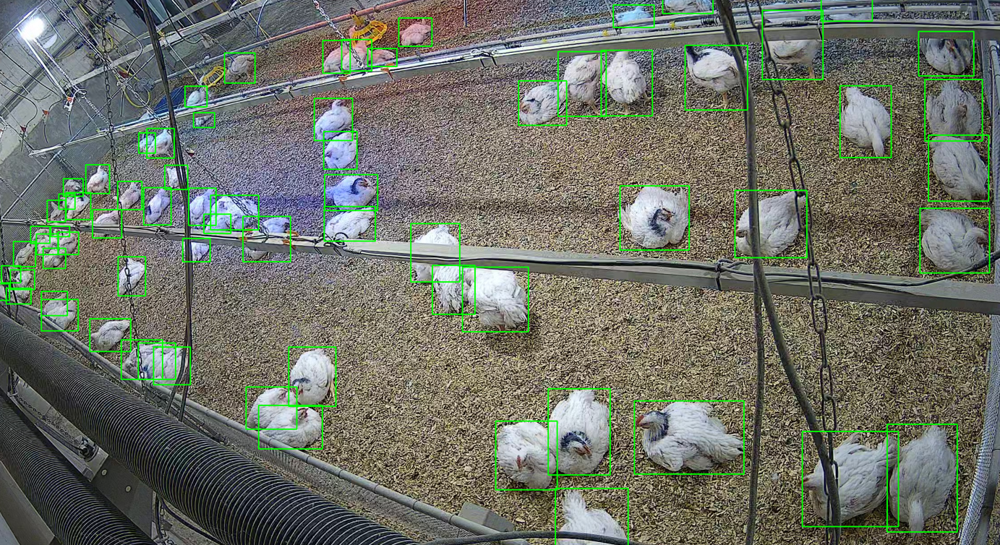

# Multi-View Broiler Tracking


This repository accompanies [**Multi-camera Detection and Tracking for Individual Broiler Monitoring**](https://www.sciencedirect.com/science/article/abs/pii/S0168169925005411): a pipeline for single-view detection, multi-view ground-plane detection, and multi-view tracking of broilers across their lifespan.

- **Setup and codebase** — [Getting Started](#getting-started) (clone, conda, `install.sh`, `PYTHONPATH`) and [Main Scripts](#main-scripts) (`sv_main.py`, `mv_main.py`, `mvt_main.py`).
- **MVBroTrack** — [Dataset download, label overview, and visualizers](#mvbrotrack-dataset) (`scripts/visualize_*.py`).
- **Reference** — [Citation](#reference) for the paper and dataset.

## Getting Started

### Clone (with submodules)

```bash
git clone --recurse-submodules https://github.com/decide-ugent/multi-view-broiler-tracking.git
cd multi-view-broiler-tracking
```

### Installation

**Dataset:** Download and unzip [MVBroTrack](#mvbrotrack-dataset) into `DATA/` before running training, evaluation, or the visualization scripts (default location: `DATA/MVBroTrack`).

#### System dependencies (Linux)

Install these before running `./install.sh` (needed to build the muSSP native extension):

| Package | Purpose |
|---|---|
| `unzip` | Extract `mussp-master-6cf61b8.zip` |
| `cmake` | Configure the muSSP C++ wrapper build |
| `build-essential` | C/C++ compiler and `make` |
| `libboost-python-dev` | Boost.Python headers/libs for the wrapper |

On Debian/Ubuntu:

```bash
sudo apt-get update
sudo apt-get install -y unzip cmake build-essential libboost-python-dev
```

On other platforms, install equivalent packages (see `mot3d/README.md` for Windows notes).

#### Python environment

Create and activate a conda environment, then run the install script:

```bash
conda create -n mvbroilertracking python=3.10 -y
conda activate mvbroilertracking
./install.sh
```

`install.sh` installs Python dependencies and builds the muSSP native extension under `mot3d/`. It does **not** install system packages. After installation, add `mot3d` to your `PYTHONPATH` when running the tracking scripts:

```bash
export PYTHONPATH="$PWD/mot3d:$PYTHONPATH"
```

---

## Main Scripts

All three scripts are run from the repository root and expect MVBroTrack in `DATA/MVBroTrack` (see [MVBroTrack Dataset](#mvbrotrack-dataset)). Tracker caches, evaluation CSVs, and other generated outputs also go under `DATA/` (see `utils/paths.py`).

### `mvt_main.py` — Multi-View Ground-Plane Tracking

Runs multi-view tracking on top of the ground-plane detections. Four tracking methods are available, covering both tracking-by-detection (TBD) and tracking-by-curve-matching (TBCM) approaches:

| Method flag | Description |
|---|---|
| `muSSP3D` | TBD using muSSP global optimisation directly on 3D detections |
| `sort_3D` | TBD using SORT on 3D detections per frame |
| `muSSP_curve` | TBCM — 2D single-camera tracklets fused as curves via muSSP |
| `sort_curve` | TBCM — 2D single-camera tracklets fused as curves via SORT |

Default configs for each method live in `ground_plane_tracking/yml_configs/`. Fold-specific tuned parameters are in `ground_plane_tracking/yml_tuned/`.

**Reproducing the paper results** (`--fold all`, the default) runs all five stratified folds using the per-fold tuned parameters and saves one CSV per fold to `DATA/final_summaries/` as `{method}_{fold_N}_{eval_set}.csv` (default `eval_set=val`, matching the paper half on current scikit-learn).

```bash
export PYTHONPATH="$PWD/mot3d:$PYTHONPATH"

# Reproduce paper results — all 5 folds, tuned params, paper test split
python mvt_main.py --method sort_3D --eval_set test
python mvt_main.py --method muSSP3D --eval_set test
python mvt_main.py --method sort_curve --eval_set test
python mvt_main.py --method muSSP_curve --eval_set test

# combine the results in a single table
python -m scripts.produce_final_tracking_paper_results_table
```

### `mv_main.py` — Multi-View Ground-Plane Detection

Projects single-view bounding boxes to the ground plane via camera calibration, fuses detections across all four camera views, and evaluates using MOD metrics (MODA / MODP / Precision / Recall). Supports 5-fold cross-validation and hyperparameter tuning.

```bash
# Evaluate all folds
python mv_main.py --action test

# Evaluate on a specific camera subset
python mv_main.py --action test --cam_set 9 10

# Tune hyperparameters on one fold
python mv_main.py --action tune --fold fold_1
```

---

### `sv_main.py` — Single-View Detection (YOLO)

Handles 5-fold cross-validation training, final model training, and inference for single-view broiler detection using YOLO. 

```bash
# Train a single fold
python sv_main.py train_single_fold --fold fold_1 --image_size 1920 --model yolo11x.pt

# Validate a trained fold model
python sv_main.py validate --fold fold_1 --image_size 1920 --model yolo11x

# Train final model on all data
python sv_main.py train_final_model --model yolo11x.pt --image_size 1920

# Run inference on images (uses bundled weights or a trained run under DATA/GENERATED_DATA/)
python sv_main.py gather_detections --image_size 1920
```

---

## MVBroTrack Dataset

Download and unzip into `DATA/`:

```bash
mkdir -p DATA
wget https://datasets.ilabt.imec.be/broilertracking/MVBroTrack_v2.zip -O DATA/MVBroTrack_v2.zip
unzip DATA/MVBroTrack_v2.zip -d DATA
rm DATA/MVBroTrack_v2.zip
```

After unzipping, the dataset root (`DATA/MVBroTrack` by default) should contain `Single-View-Detection/`, `Multi-View-Detection/`, `Multi-View-Tracking/`, `Calibrations/`, and `Reprojection_Masks/`. Set `MVBROTRACK_DATASET_ROOT` to override the default for all scripts, or pass `--root_dataset` to `mv_main.py` and `--dataset_root` to the visualization scripts.

The MVBroTrack dataset covers broilers across three growth stages (Starter, Grower, Finisher) and provides annotations for single-view detection, multi-view detection, and multi-view tracking.

**Visualizers** (run from the repository root with `python -m`, same as other entry points; deps from `install.sh`):

```bash
# single-view images with bounding boxes
python -m scripts.visualize_single_view_dataset 

# four-camera grid, ground-plane GT, optional YOLO via `--yolo_labels_folder`, confidence trackbar
python -m scripts.visualize_ground_plane_detection_dataset 

# synchronized playback with ground-plane track history (e.g. `--start-frame 400`)
python -m scripts.visualize_ground_plane_tracking_dataset 
```


### Labels per Subtask

| Task | Stage | Frames | Broilers | Image Plane (BBoxes) | Ground Plane (Points) | Ground Plane (Tracks) |
|---|---|---|---|---|---|---|
| Single-view detection | Starter | 56 | 4106 | 4106 | - | - |
| | Grower | 65 | 5714 | 5714 | - | - |
| | Finisher | 114 | 11414 | 11414 | - | - |
| | **Total** | **235** | **21234** | **21234** | - | - |
| Multi-view detection | Starter | 7×4 | 893 | - | 893 | - |
| | Grower | 21×4 | 2791 | - | 2791 | - |
| | Finisher | 23×4 | 3022 | - | 3022 | - |
| | **Total** | **51×4** | **6706** | - | **6706** | - |
| Multi-view tracking | Starter | 1423×4 | 275 | - | - | 275 |
| | Grower | 1494×4 | 276 | - | - | 276 |
| | Finisher | 1439×4 | 265 | - | - | 265 |
| | **Total** | **4356×4** | **816** | - | - | **816** |

### Single-View Ground Truth Detections



### Multi-View Ground Truth Tracks

One camera view out of the four synchronized views, with ground-plane tracks visualized using up to 12 seconds of track history.


---

## Reference

If you found this dataset or the accompanying code useful, please cite:

```bibtex
@article{CARDOEN2025110435,
  title   = {Multi-camera detection and tracking for individual broiler monitoring},
  journal = {Computers and Electronics in Agriculture},
  volume  = {237},
  pages   = {110435},
  year    = {2025},
  issn    = {0168-1699},
  doi     = {https://doi.org/10.1016/j.compag.2025.110435},
  url     = {https://www.sciencedirect.com/science/article/abs/pii/S0168169925005411},
  author  = {Thorsten Cardoen and Patricia Soster {de Carvalho} and Gunther Antonissen and Frank A.M. Tuyttens and Sam Leroux and Pieter Simoens},
  keywords = {Multi-camera detection, Object tracking, Broiler welfare monitoring, Sensor fusion}
}
```